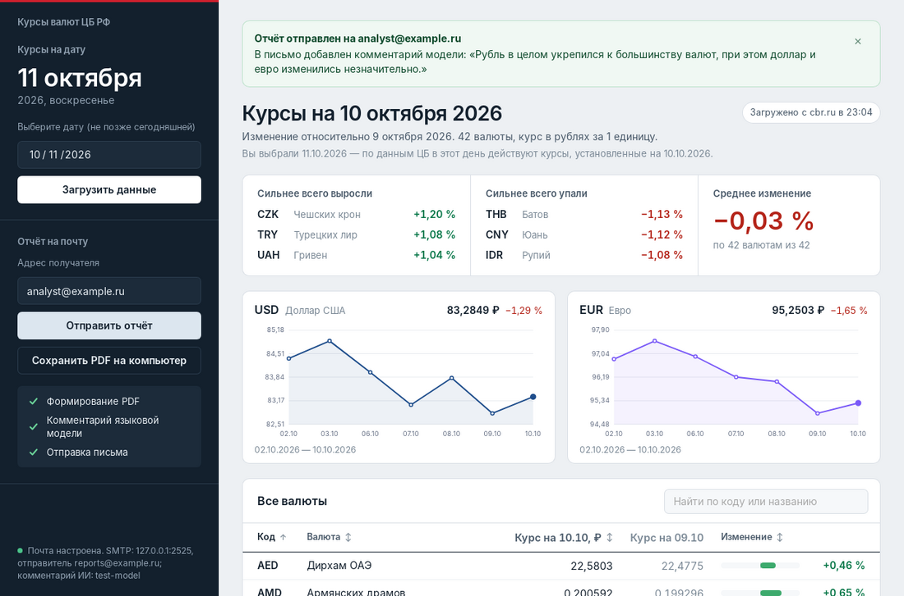
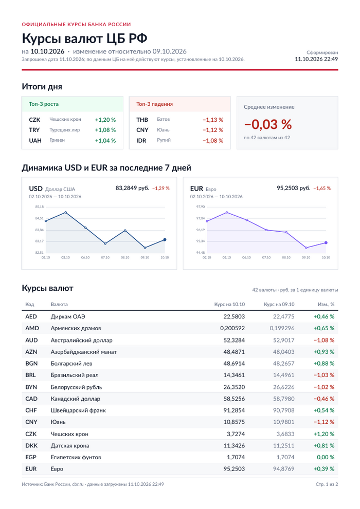

# Курсы валют ЦБ РФ

Десктопное приложение на .NET 9 (Photino Blazor), которое выполняет сценарий
**выбор даты → загрузка курсов с сайта ЦБ РФ → обработка → PDF-отчёт → отправка по почте**.



<sub>Скриншот и пример отчёта сделаны на тестовых данных.</sub>

## Что умеет

- Загружает официальные курсы с `https://www.cbr.ru/scripts/XML_daily.asp` на выбранную дату
  (не позже сегодняшней) и на **предыдущий доступный день** — его ищем по атрибуту `ValCurs/@Date`,
  а не по календарю, поэтому выходные и праздники обрабатываются корректно.
- Приводит курс к одной единице валюты с учётом номинала (в XML десятичный разделитель — запятая),
  считает изменение в процентах, топ-3 выросших и топ-3 упавших валют и среднее изменение.
- Показывает таблицу (код, название, курс, изменение) с поиском и сортировкой, итоги дня
  и графики USD/EUR; индицирует этапы операций (загрузка, формирование PDF, комментарий ИИ, отправка).
- Формирует PDF: заголовок и дата, итоги дня, график USD/EUR за 7 дней, таблица курсов.
- Отправляет письмо: тема «Курсы валют ЦБ РФ на {дата}», в теле — топ-3 роста и падения
  (и комментарий языковой модели, если он настроен), во вложении — PDF.
- Сохраняет PDF на диск без отправки (работает и без сети).

<details>
<summary>Пример первой страницы PDF-отчёта</summary>



</details>

## Архитектура

```
alfa_test_proj.sln
├── src/alfa_test_proj.Core     библиотека: вся логика
├── src/alfa_test_proj.UI       Photino Blazor: только интерфейс
└── tests/alfa_test_proj.Core.Tests   xUnit-тесты Core
```

**UI не содержит бизнес-логики.** Он получает из DI единственный интерфейс
`ICurrencyReportService` и вызывает его методы; всё остальное в Core — `internal`.

```csharp
public interface ICurrencyReportService
{
    Task<RatesReport> LoadRatesAsync(DateOnly date, CancellationToken ct = default);
    IReadOnlyList<CachedRatesInfo> GetCachedEntries();
    Task<RatesReport> LoadFromCacheAsync(DateOnly requestedDate, CancellationToken ct = default);
    Task<string> SavePdfAsync(RatesReport report, IProgress<ReportStage>? progress = null, CancellationToken ct = default);
    Task<ReportSendResult> SendReportAsync(RatesReport report, string recipient,
        IProgress<ReportStage>? progress = null, CancellationToken ct = default);
    string? ValidateRecipient(string? recipient);
    ConfigurationStatus CheckConfiguration();
}
```

Регистрация в UI — одна строка: `builder.Services.AddCurrencyReportCore();`

Внутреннее устройство Core:

| Папка | Ответственность |
|---|---|
| `Loading/` | `ExchangeRateLoader` (HttpClient, поиск предыдущего дня, динамика USD/EUR через `XML_dynamic.asp`), `CbrXmlParser` (windows-1251, запятая, номинал) |
| `Processing/` | `RatesAnalyzer` — изменение в %, топ-3, среднее (чистые функции) |
| `Reporting/` | `PdfReportGenerator` (QuestPDF), `RateChartSvg` (график в SVG), `Format` (русское форматирование чисел) |
| `Email/` | `ReportEmailComposer` (тема, текст, вложение), `SmtpReportSender` (MailKit), `EmailAddressValidator` |
| `Configuration/` | чтение и проверка `config.json` |
| `Caching/` | локальный кэш загруженных данных |
| `Logging/` | файловый логгер |
| `Llm/` | комментарий языковой модели (OpenAI-совместимый API) |
| `Errors/` | типизированные исключения |
| `CurrencyReportService` | оркестрация сценария |

### Обработка ошибок

Все ожидаемые ошибки Core бросает как наследников `CurrencyReportException`; их `Message` — готовый
текст для пользователя, техническая причина — в `InnerException` и в логе. UI оборачивает каждую
операцию в общий обработчик и показывает сообщение в баннере; на случай непредвиденного есть
`ErrorBoundary` и глобальные обработчики исключений — приложение не завершается аварийно.

| Ситуация | Исключение | Что видит пользователь |
|---|---|---|
| Нет сети, сайт ЦБ недоступен, HTTP-ошибка, таймаут | `RatesSourceUnavailableException` | «Не удалось подключиться к сайту ЦБ РФ…»; если в кэше есть данные на эту дату — они открываются автоматически |
| Пустой ответ, не XML, нет курсов | `InvalidRatesResponseException` | «Сервис ЦБ РФ вернул некорректный ответ…» |
| Некорректный адрес получателя | `InvalidRecipientException` | ошибка под полем ввода, письмо не формируется |
| Ошибка SMTP (подключение, TLS, логин/пароль, отказ сервера) | `EmailSendException` | конкретная причина и что проверить в конфиге |
| Нет `config.json`, битый JSON, не заполнен SMTP | `ConfigurationException` | путь к файлу и что исправить; статус конфига виден в левой панели |

## Настройка

1. Скопируйте шаблон и заполните параметры SMTP:

   ```bash
   cp config.example.json config.json
   ```

   `config.json` лежит в корне репозитория, он в `.gitignore` и никогда не попадал в историю коммитов.
   При сборке UI файл копируется рядом с исполняемым файлом (`bin/.../config.json`) — оттуда его
   и читает приложение. Конфиг перечитывается при каждой отправке, так что после правки
   достаточно пересобрать/перезапустить или поправить копию в `bin`.

2. Параметры:

   | Ключ | Описание |
   |---|---|
   | `Smtp.Host`, `Smtp.Port` | SMTP-сервер и порт |
   | `Smtp.UserName`, `Smtp.Password` | логин и пароль (для Яндекс/Mail.ru/Gmail — **пароль приложения**). Пустой логин — без аутентификации |
   | `Smtp.FromAddress`, `Smtp.FromName` | адрес и имя отправителя (обычно адрес = логин) |
   | `Smtp.Security` | `Auto` (по умолчанию), `SslOnConnect`, `StartTls`, `StartTlsWhenAvailable`, `None` |
   | `Smtp.TimeoutSeconds` | таймаут SMTP, по умолчанию 30 |
   | `Llm.*` | необязательно, см. ниже |

   Примеры: Яндекс — `smtp.yandex.ru`, 465, `SslOnConnect`; Mail.ru — `smtp.mail.ru`, 465, `SslOnConnect`;
   Gmail — `smtp.gmail.com`, 587, `StartTls`.

3. (Необязательно) комментарий языковой модели в письме. Подходит любой API, совместимый с
   OpenAI Chat Completions — OpenAI, DeepSeek, OpenRouter, YandexGPT (OpenAI-совместимый эндпоинт),
   локальная Ollama:

   ```json
   "Llm": {
     "Enabled": true,
     "Endpoint": "https://api.openai.com/v1/chat/completions",
     "ApiKey": "sk-...",
     "Model": "gpt-4o-mini",
     "TimeoutSeconds": 20
   }
   ```

   Если модель недоступна, письмо уходит без комментария (причина пишется в лог).

## Запуск

Нужен [.NET 9 SDK](https://dotnet.microsoft.com/download/dotnet/9.0).

```bash
dotnet run --project src/alfa_test_proj.UI
```

- **Windows 10/11** — WebView2 обычно уже установлен вместе с Edge.
- **Linux** — нужен WebKitGTK: `sudo apt install libwebkit2gtk-4.1-0 libnotify4`.
- **macOS** — работает «из коробки».

Тесты:

```bash
dotnet test
```

### Где лежат файлы приложения

Рядом с исполняемым файлом (`src/alfa_test_proj.UI/bin/Debug/net9.0/`):

| Папка | Что внутри |
|---|---|
| `logs/app-yyyyMMdd.log` | журнал операций |
| `cache/rates-yyyy-MM-dd.json` | кэш загруженных данных (последние 30 дат) |
| `reports/` | PDF, сохранённые кнопкой «Сохранить PDF на компьютер» |

## Использованные библиотеки

| Пакет | Зачем |
|---|---|
| [Photino.Blazor](https://github.com/tryphotino/photino.Blazor) | десктопное окно с Blazor-интерфейсом |
| [QuestPDF](https://www.questpdf.com/) | PDF-отчёт (Community-лицензия) |
| [MailKit](https://github.com/jstedfast/MailKit) / MimeKit | отправка писем по SMTP |
| Microsoft.Extensions.Http | `IHttpClientFactory`, typed HttpClient |
| Microsoft.Extensions.Logging (+ Debug) | логирование |
| xUnit, Microsoft.NET.Test.Sdk | тесты |

Разбор XML — `XDocument`, конфиг — `System.Text.Json`, график — SVG, который генерирует Core
и рендерит QuestPDF (отдельная библиотека для графиков не нужна).

## Выполненные дополнительные задания

- [x] **Кэширование последних загруженных данных** с возможностью сформировать отчёт без сети.
  После каждой успешной загрузки данные сохраняются в `cache/`. Если сайт ЦБ недоступен, данные на
  выбранную дату берутся из кэша автоматически (в интерфейсе — пометка «Из кэша»), а на стартовом
  экране есть список сохранённых дат. Из таких данных можно сохранить PDF и отправить отчёт.
- [x] **Логирование операций в файл** — собственный `FileLoggerProvider` без внешних зависимостей,
  файл на каждый день в `logs/`.
- [x] **График динамики USD и EUR за последние 7 дней в PDF** — по данным `XML_dynamic.asp`
  (тоже официальный XML-сервис ЦБ), 7 последних дат с установленными курсами. Тот же график
  показывается в интерфейсе.
- [x] **Комментарий языковой модели в теле письма** (1–2 предложения) — через OpenAI-совместимый API,
  включается в `config.json`.

Сверх задания: модульные тесты Core (70 тестов), сохранение PDF без отправки, поиск и сортировка
в таблице.

## Решения и допущения

- **Дата в теме письма и отчёте** — фактическая дата курсов из `ValCurs/@Date`. Если пользователь
  выбрал, например, воскресенье, отчёт будет «на субботу», и интерфейс/PDF это поясняют.
- **Топ-3 роста/падения** включают только реально выросшие/упавшие валюты: в спокойный день список
  может быть короче трёх. При равенстве изменений порядок — по коду валюты.
- **Среднее изменение** — среднее арифметическое процентных изменений по всем валютам, для которых
  есть курс в предыдущий день (новая валюта без истории в среднее не входит, в таблице у неё «—»).
- Курсы мелких валют (VND, IDR, UZS…) после деления на номинал показываются с 6 знаками после
  запятой, остальные — с 4, как публикует ЦБ.
- В PDF вместо «₽» написано «руб.»: встроенный в QuestPDF шрифт Lato не содержит знака рубля,
  а системные шрифты QuestPDF 2026.9 намеренно не использует (отчёт выглядит одинаково на любой машине).
- Сайт ЦБ иногда отвечает 403 запросам без `User-Agent`, поэтому HttpClient его отправляет.
